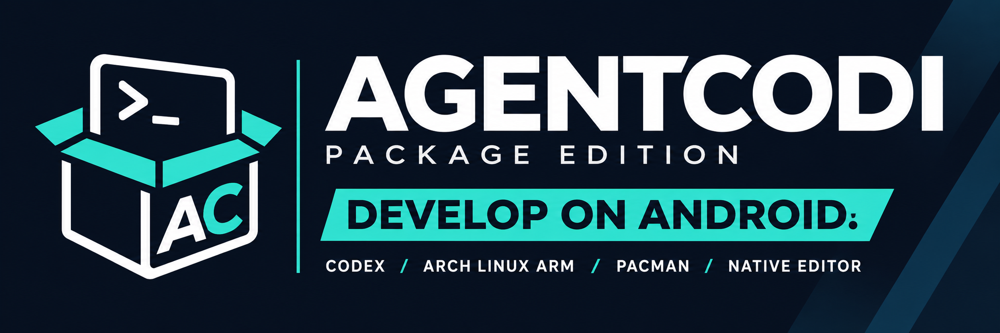

# AGENTCODI Package Edition

<div align="center">

### Work with Codex and development tools on your Android device

[Download](https://github.com/Mcpasi/AGENTCODI-Package-Edition/releases) · [Website](https://devsblog.com/) · [Report a bug](https://github.com/Mcpasi/AGENTCODI-Package-Edition/issues) · [Changelog](CHANGELOG.md) · [Standard Edition](https://github.com/Mcpasi/AGENTCODI)


</div>



AGENTCODI Package Edition brings Codex and development tools to your Android phone or tablet. Ask Codex to explain a project, edit files or run commands, and follow its work in the chat. You can also edit files yourself, use the built-in terminal and install tools such as Python, Node.js and Git.

Your project files, terminal and development tools run on your device. Codex requests need an internet connection and a sign-in. You don't need to install Termux or set up a separate gateway.

Package Edition can be installed alongside [AGENTCODI Standard Edition](https://github.com/Mcpasi/AGENTCODI). The two apps have separate files, settings and sign-ins.

> **Version note:** Version 0.1.9 has been successfully tested and is stable. It includes [Arch Terminal](https://github.com/Mcpasi/Arch_Terminal) 0.2.0 unchanged, replacing the previous terminal, APT bootstrap and package catalog. The published 0.1.6 APKs use the older APT environment. The Arch instructions in this README apply to builds from `main`.

## Screenshots

<p align="center">
  
  
  
</p>
<p align="center">
  
  
</p>

## What you can do

- Chat with Codex and follow its responses, plans, commands and file changes as they arrive.
- Read selectable Markdown responses, including code blocks, tables, lists and links, and view generated images in the chat.
- Run commands in the terminal and install the tools you need.
- Edit workspace files with syntax highlighting for JavaScript, HTML, CSS and Python.
- Import and export files using Android's file picker. The workspace is the app's folder for your project files.
- Browse and export files from installed packages in separate, read-only views.
- Connect MCP servers to give Codex access to additional tools. Each managed MCP tool request requires your approval.
- Use the interface in English, German or Simplified Chinese. The app detects your device language automatically.

## Before you install

You'll need **Android 10 or newer**, an **ARM64 (arm64-v8a) device** and an internet connection for Codex and package downloads.

> [!IMPORTANT]
> **Package Edition is intended for experienced users and always runs with Full access.**
>
> Codex and installed programs can read, change or delete files accessible to AGENTCODI, including its account data. You can enable command approvals, but these do not restrict programs to the project folder. Android still separates AGENTCODI from other apps. See [SECURITY.md](SECURITY.md) for details.

## Get started

1. For an Arch integration build, download the APK from a successful **APK** or **APK Release** Actions run on `main`. The [published 0.1.6 release](https://github.com/Mcpasi/AGENTCODI-Package-Edition/releases/tag/v.0.1.6.package.3) uses the previous APT environment.
2. Open the APK on your device and install it. If Android asks, allow installation from the app you used to download or open the file.
3. In an Arch integration build, open **Terminal** and choose **Arch installieren / fortsetzen**. The first download is about 791 MiB; allow at least 5 GiB of free internal storage. Then open **Settings** and tap **Start Codex runtime**. You can also use terminal sessions without Codex.
4. In **Settings**, choose **Sign in with ChatGPT** and complete the sign-in in your browser, or enter an OpenAI API key using the account controls.
5. Tap **New chat** to get started. Ask Codex to create something, or use **Import files** to bring an existing project into the workspace.

Open **Terminal** whenever you want to run commands yourself. The next section explains how to install development tools.

Android may show an installation warning because the app targets an older Android API. This allows development tools to run from the app's writable storage. The app still requires Android 10 or newer.

## Install development tools

In **Terminal**, complete the Arch installation and initialize its keyring at the first login. Then update Arch and install tools with pacman:

```sh
pacman -Syu
pacman -S git python python-pip nodejs npm ripgrep
```

Use `pacman -Q` to list installed packages and `pacman -R <package>` to remove one. Arch Terminal manages mirrors and package signatures. The former AGENTCODI APT repository and catalog are no longer included in this source build.

Terminal sessions and Codex commands share the same Arch installation and workspace. The workspace is available at `/workspace` and at the original absolute path used by the editor and file APIs. Arch packages are stored inside `files/arch`, and the guest home is `/root`.

For Python packages, use a project virtual environment. For Node packages, use the usual npm commands. If you install a program to use as a direct stdio MCP command, restart the Codex runtime so its host launcher is refreshed.

Data from the old APT environment and `$HOME/.local` remains available for export in the legacy read-only browser areas. Those binaries are no longer on the active command and library paths, and they are not converted into pacman packages.

## Work with files

The file browser shows your **Workspace** alongside read-only areas for **Earlier APT packages** and **Earlier user packages**. You can export files from those older installations. To inspect the active Arch installation and its pacman packages, use Terminal.

Imported files are placed in `workspace/imports`. Importing an archive or DEB file copies it there; use Terminal if you want to unpack or install it.

You can export files and folders through Android's file picker. Folders are exported as ZIP archives. Known credential paths, such as `auth.json` and `.ssh`, are excluded from package previews and exports. Review your files before sharing them, especially if you have saved credentials under other names.

ZIP exports are useful for moving files, but they don't preserve executable permissions, links or empty directories. They are therefore not complete backups of installed packages.

### Workspace editor

The workspace editor is included in published APKs from version 0.1.5 onward.

Open a text or code file in **Workspace** to edit it, or tap **New file** inside a folder. Tap **Save** when you're done, or press **Ctrl+S** on a hardware keyboard. A new file is created when you save it for the first time.

The editor shows line numbers, wraps long lines and highlights JavaScript, HTML, CSS and Python. It marks unsaved changes and offers **Save**, **Discard** or **Cancel** when you leave or refresh. If another program changes the file while you're editing, the editor reports a conflict when you save and keeps your draft.

You can edit UTF-8 text files up to 1 MiB. Images, binary files, larger text files and installed package files open as read-only previews. Saving preserves the file's existing line endings, UTF-8 byte order mark and executable permissions. Save your changes before exporting a file.

To run saved code, open **Terminal** in the file's folder and use the appropriate tool. For example, after installing Python with `pacman -S python`, run a file with `python example.py`.

## Approvals and extra tools

In **Settings**, enable **Confirm file changes and commands** if you want Codex to ask before changing files or running commands beyond recognized safe reads. Full access remains active.

Managed MCP servers ask for approval before every tool call. The dialog shows the server, request and redacted parameters. **Allow** runs that call once; **Decline** or **Cancel** closes the dialog without running it. MCP forms requiring extra fields or URL-based input are not currently supported.

## Updating the app

Install a newer release APK over the existing app to keep your files, settings and installed packages. In Arch integration builds, run `pacman -Syu` separately to update Arch packages.

If Android refuses an update because the signing certificate differs, you may have an older development build. Export any files you need before uninstalling it: uninstalling deletes the app's private data.

When reporting a bug, include the app version, Android version, device model and steps to reproduce the problem. Use [Issues](https://github.com/Mcpasi/AGENTCODI-Package-Edition/issues) for bugs and follow [SECURITY.md](SECURITY.md) for security concerns.

## Versions

- **0.1.9, tested and stable:** Arch Terminal 0.2.0 provides a shared Arch environment for terminal sessions, Codex and stdio MCP tools. Development tools are installed with pacman. This version also fixes hardlink handling in generated Arch launchers and improves masking of quoted passwords in crash reports and chat, including streamed output and escaped quotes.
- **Verification for 0.1.9:** Testing succeeded. Earlier local verification also passed 392 Java host tests, 19 Arch integration tests and architecture checks.
- **Since 0.1.6:** selectable native Markdown in answers, reasoning and plan cards, and inline previews of generated images and image-view results.
- **Since 0.1.5:** the workspace editor, a separate Package Edition icon and an Android freedom page in Settings.

See the [changelog](CHANGELOG.md) for full release notes and the [roadmap](ROADMAP-package-edition.md) for ongoing work and benchmark results.

## Technical details

<details>
<summary>App identity and Android compatibility</summary>

Package Edition uses the application ID `de.agentcodi.pkg` and has private storage separate from regular AGENTCODI.

It uses `targetSdk 28` to allow execution from its writable package directory. The minimum supported version is Android 10 / API 29.

Version 0.1.9 uses Android `versionCode 12`.

</details>

<details>
<summary>Arch Terminal integration</summary>

The unchanged upstream snapshot is pinned at `5c51fdfcec0bf55349b61b6dc3fc49d1923438c3`, with a SHA-256 check for each file. PRoot runs Arch Linux ARM aarch64 under Android without a separate app or root access. Rootfs downloads retain upstream's pinned size, SHA-256 and installation transaction. PRoot is not a separate security boundary.

The [integration guide](scripts/arch-terminal/README.md) describes the shared workspace, command adapters, native build and corresponding source artifacts.

</details>

<details>
<summary>Codex runtime and access model</summary>

The app pins the Community Android ARM64 runtime from [DioNanos/codex-termux](https://github.com/DioNanos/codex-termux), release [v0.156.1-termux.1](https://github.com/DioNanos/codex-termux/releases/tag/v0.156.1-termux.1), based on OpenAI Codex `rust-v0.156.1`. Runtime archives, source revisions, native binaries, schema files and integration hashes are pinned and verified in CI.

Full access is the only runtime mode. Optional command and file confirmation uses Codex's `untrusted` policy. Programs installed through pacman, npm, pip or other tools run with AGENTCODI's app permissions. The workspace, `HOME`, `CODEX_HOME` and Arch rootfs are separate directories, but this does not isolate programs from account files.

</details>

<details>
<summary>Build and verification</summary>

The repository contains the application sources, unchanged Arch Terminal snapshot, build scripts and CI checks. For more detail, see:

- [Package Edition roadmap](ROADMAP-package-edition.md)
- [Package build contract](scripts/package-edition/README.md)
- [Test contract](scripts/package-edition/TEST_CONTRACT.md)
- [CI guide and portable host drivers](.github/ci/README.md)
- [Repository setup and workflow inputs](.github/ci/PACKAGE_EDITION_SETUP.md)
- [Release signing](.github/ci/RELEASE_SIGNING.md)

The complete APK runner uses its pinned ARM64 build container. Portable checks can also run on a Linux host:

```sh
bash .github/ci/run-java-tests.sh
python3 -B .github/ci/test-arch-terminal.py
bash scripts/check-architecture.sh
```

APK builds run on `main`. The Tests workflow checks all branches and pull requests. A reusable native-runtime job replaces the former APT bootstrap dependency, while the existing APK container and signing path remain. CI checks app identity, DEX, APK contents, ARM64 compatibility, alignment, signing, Arch integration and source and license material.

</details>

## Source code and licenses

AGENTCODI is an independent open-source project and is not affiliated with or endorsed by OpenAI.

The original AGENTCODI code, tests, resources, build automation and documentation remain licensed under [Apache 2.0](LICENSE), copyright 2026 Pascal (Mc Pasi). Integrating Arch Terminal does not change the license of that original work.

Arch Terminal's main application code is authored by Mcpasi and licensed under [GPL-3.0-or-later](third_party/arch-terminal/LICENSE). It includes third-party components such as PRoot, talloc, libarchive and the Termux terminal emulator/view. These retain their own authorship, licenses and copyright notices.

The combined APK containing Arch Terminal is distributed under GPL-3.0-or-later. The combined application source bundle, Arch Terminal sources and native input archives accompany the build artifacts. See [NOTICE.md](NOTICE.md), [Arch Terminal's component notices](third_party/arch-terminal/NOTICE.md) and the notices in the app.

Complete original sources for the Codex runtime's MPL-2.0 components are included in the APK. You can export them without an account or internet connection:

**Settings > Licenses and notices > Codex dependency notices > Save MPL sources**

More source and license documentation:

- [Community Codex dependency licenses and provenance](third_party/community-codex/README.md)
- [MPL source offer, archive hashes and upstream locations](third_party/community-codex/MPL-SOURCE-OFFER.txt)
- [Arch Terminal sources and notices](third_party/arch-terminal/NOTICE.md)
- [Package build contract](scripts/package-edition/README.md)
